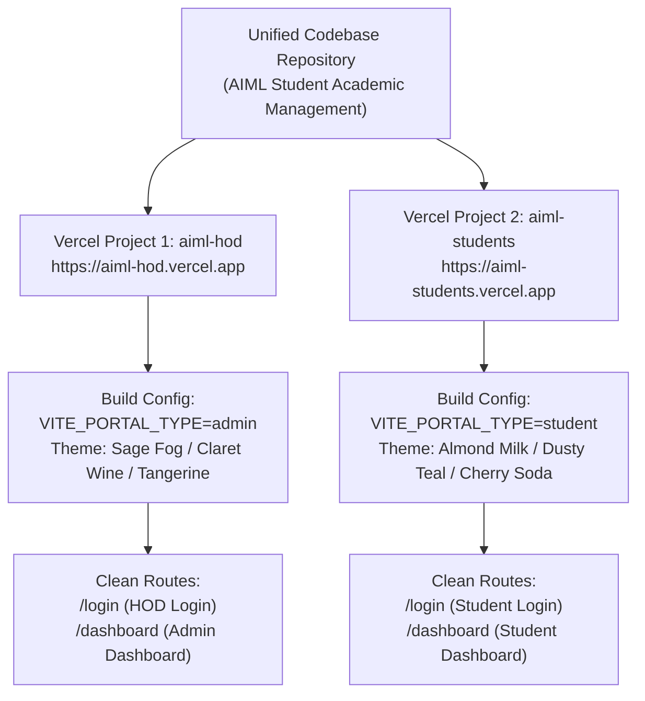

# Independent Vercel Deployments Guide
## AIML Department Student Academic Management System
**DVR & Dr. HS MIC College of Technology** &bull; **Department of Artificial Intelligence and Machine Learning (AIML)**

---

### Architecture Overview

The system is engineered as a single, modular codebase supporting **two completely independent frontend deployments** on Vercel:



Both portals connect seamlessly to the same future backend REST API and Supabase database. Real role-based access control (RBAC) is enforced at the API layer.

---

### Project 1: HOD / Admin Portal

- **Example Production URL**: `https://aiml-hod.vercel.app`
- **Purpose**: Department-level student administration, multi-criteria directory filters, year-specific update tracking, academic analytics, and institutional report downloads.

#### Exact Vercel Configuration Settings:
1. **Project Name**: `aiml-hod` (or your preferred administrative domain)
2. **Framework Preset**: `Vite`
3. **Root Directory**: `client`
4. **Build Command**: `npm run build`
5. **Output Directory**: `dist`
6. **Environment Variables**:
   | Variable Key | Variable Value | Description |
   | :--- | :--- | :--- |
   | `VITE_PORTAL_TYPE` | `admin` | **Locks build to HOD Admin Portal** |
   | `VITE_API_URL` | `https://api.yourdomain.ac.in` | Future Express Backend URL |

---

### Project 2: Student Portal

- **Example Production URL**: `https://aiml-students.vercel.app`
- **Purpose**: Individual student academic portal with full profile editing, 8-semester CGPA record updates, and cohort-specific update request fulfillment.

#### Exact Vercel Configuration Settings:
1. **Project Name**: `aiml-students` (or your preferred student portal domain)
2. **Framework Preset**: `Vite`
3. **Root Directory**: `client`
4. **Build Command**: `npm run build`
5. **Output Directory**: `dist`
6. **Environment Variables**:
   | Variable Key | Variable Value | Description |
   | :--- | :--- | :--- |
   | `VITE_PORTAL_TYPE` | `student` | **Locks build to Student Portal** |
   | `VITE_API_URL` | `https://api.yourdomain.ac.in` | Future Express Backend URL |

---

### Single Page Application (SPA) Routing Configuration

Both deployments utilize [client/vercel.json](file:///c:/Users/shaik/Documents/UXI%20projects/Department%20Student%20marks/client/vercel.json) to route all paths cleanly to `/index.html`:

```json
{
  "rewrites": [
    {
      "source": "/(.*)",
      "destination": "/index.html"
    }
  ]
}
```

This guarantees seamless browser refreshes on `/login` and `/dashboard` without 404 errors.
